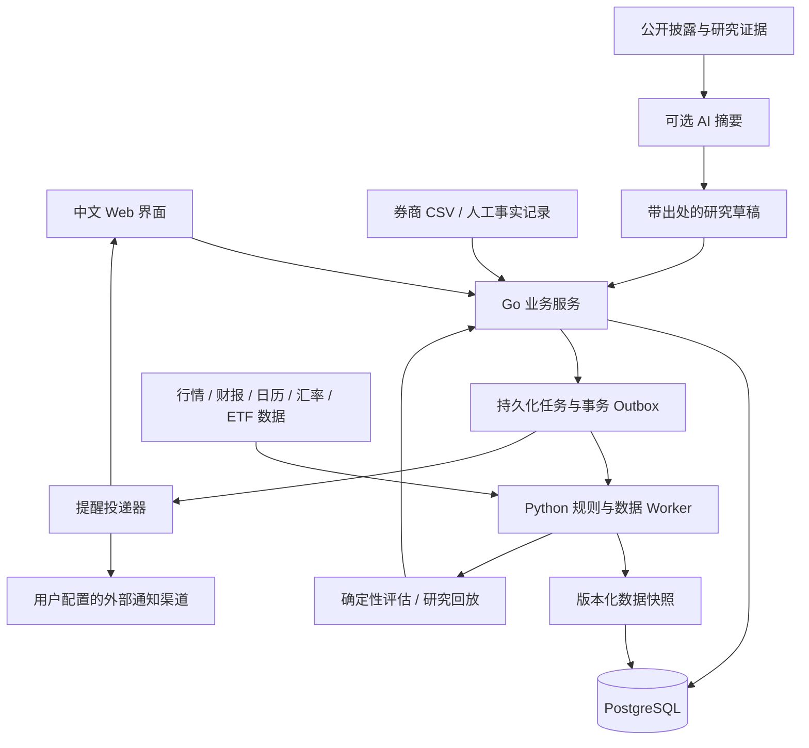

# 系统设计

2026-11-05最新实现见[网页工作台](36-web-workspace.md)：静态HTML/CSS/JS，Go仅嵌入静态资源并代理API，FastAPI承载当前业务和单进程后台任务。手工持仓快照、共享扫描池及研究已接入，A股暂不参与；完整账户账本/风险/多用户仍未实现。下文是早期总体设计，不表示全部已落地；本轮未运行应用或测试。

版本：v0.1；日期：2026-10-23。本文描述待实现结构，所有模块目前均未实现。

## 1. 总体架构

采用单用户、模块化单体业务服务，配套 Python 计算工作进程。初期一台服务器部署即可，不引入独立消息中间件或复杂微服务集群。

Go 管理账户、账本、配置、计划状态、并发预约、鉴权与事务；Python 管理数据清洗、指标、股票池、策略、统一风险计算和回测。AI 关闭或不可用时，核心流程仍工作。

前端采用一个轻量 Web 应用，具体框架可在实现时按维护成本决定，不影响业务契约。任何页面设计必须遵循产品文档的信息优先级。

首个独立交付按 [个股研究模块](07-stock-research-module.md) 切出行情、技术结构、财务/前瞻/电话会、估值和报告链路。复用本架构的数据、任务、证据与版本模块；可先运行而不要求账户账本已完成。财报/电话会原文使用可备份文件或对象存储，PostgreSQL保存索引和结构化数据；自建行情持久化不能被yfinance内部缓存替代。

第二产品模块按 [趋势、策略与观察池](08-trend-strategy-module.md) 实现，复用第一模块快照，输出分周期趋势、逐策略检查与机会状态。趋势分类器是唯一领域实现，第一模块如需展示三态趋势也读取该服务结果，避免循环依赖：底层行情/结构计算不依赖完整研究报告或趋势路由。

## 2. 模块边界

| 模块 | 职责 | 关键规则 |
| --- | --- | --- |
| Account & Ledger | 现金、持仓、外部资金流、企业行动、成本与对账 | EQ-01/02、BOOK-07 |
| Configuration | 校验、版本、生效、影响预览 | GOV-01、PLAN-04 |
| Market Data | 数据适配、时点快照、质量、日历 | GOV-02/05、UNI-04 |
| Research & Universe | 可交易池、研究卡、候选雷达、证据 | UNI-01/02/03 |
| Portfolio Risk | 风险状态、规模计算、压力情景、集中度 | RSK-01/02/03、BOOK-01/04 |
| Trend & Watchlist | 多周期分类、策略适用性、主观察记录、机会episode与变化重评 | 第二模块TREND规则、UNI-03 |
| Strategy Engine | 四个交易模板、持有/退出条件、共用事件规则 | STR-01/02/03/04/05 |
| Plans & Reservations | 生命周期、预算预约、修订与成交关联 | PLAN-01/02/03/04 |
| Alerts | 触发、去重、送达、健康状态 | ALT-01/02/03/04 |
| Review & Replay | 绩效、行为、可重放研究 | REV-01/02/03/04/05 |

## 3. 唯一规则实现与并发一致性

在线、历史回放、模拟账户调用同一个 Python 领域规则包。它接收显式的时点快照与版本，返回结构化判断，不能自行读取“现在”的配置或隐藏网络数据。Go 不重新实现另一套仓位/保护线公式。

评估请求包含 account_snapshot_version、config_version、strategy_version、market_snapshot_id、evaluation_time、reserved_budget_version。响应包含 PASS/BLOCKED/UNKNOWN、原因代码、数值输入、风险贡献、建议数量、数据时间和 validity_until。

计划激活流程：

1. 对确定版本的账户与预约快照评估。
2. Go 在数据库事务内锁定账户预算行，检查输入版本与有效时间。
3. 版本不一致则重新评估，不能直接使用旧 PASS。
4. 通过后同一事务写入计划状态、现金/风险/名额预约与 outbox 事件。
5. 部分成交把对应预约转换为实际持仓占用，剩余预约保留；过期/取消仅释放剩余部分。

风险资金池、账户总风险和计划名额必须同一原子操作检查。行情新鲜度在提交时再次检查；有重大市场/风险状态变化时使评估过期。重试以幂等键识别，不重复预约。

Python 超时、返回 UNKNOWN 或版本冲突未解决时，新增风险操作停留待评估。真实成交入账、查看已有持仓和记录减仓不依赖 AI 或成功计算新入场。

## 4. 核心数据模型

以下是实体契约，具体 SQL 在实现阶段确定。

| 实体 | 关键字段/约束 |
| --- | --- |
| accounts | 基准币种、时区、券商标识、运行模式、当前版本；币种未填可为 setup_incomplete |
| config_versions | 不可变配置、父版本、作者、原因、创建/生效时间、状态 |
| risk_baselines | 参考本金、基准时点、现金流政策、单位净值起点、历史基准链接 |
| ledger_events | 现金/证券变动类型、数量、金额、币种、费用、发生/记录时间、来源、冲正关联 |
| fills | 券商成交 ID、证券、方向、成交数量/价格、费用、时间、计划/分批/资金池关联；只追加 |
| cash_balances / position_lots | 账本派生视图；成本基础、数量、资金池、持仓管理状态、是否已分类；可重建 |
| book_transfers / unit_nav_events | 分池初始分配/内部划转/未分配现金；外部流的事件前估值、单位数和单位净值变化 |
| import_batches / reconciliation_issues | 文件哈希、来源、映射版本、预览、行级问题、对账差异、导入状态 |
| securities | 内部稳定 ID、证券类型、交易所、币种、代码历史、公司/基金标识 |
| corporate_actions | 拆并股、分红、合并、更名等，生效时间、来源、处理版本 |
| price_bars / quote_snapshots / fx_rates | 证券、时段、原始价格、调整因子、时点、来源、接收时间、质量 |
| filings / fundamental_facts | 原文链接/文档 ID、指标、单位、期间、披露时间、修订时间、检索时间 |
| fund_holdings / classifications | 成分、权重、行业/主题、有效日期、披露时点、数据覆盖率 |
| research_cards / evidence | 逻辑、正反证据、估值假设、失效条件、复查时间、人工/AI/计算来源 |
| candidate_events | 候选首次发现、状态变化、排名组成、当时数据快照 |
| trend_assessments / trend_change_events | 主/背景周期、判断状态、确认时间、数据/配置版本、变化依据 |
| watchlist_entries / strategy_opportunities | 主记录按证券唯一；逐策略机会episode、准备状态、失效原因与旧机会关联 |
| opportunity_evaluations / opportunity_events | 每次条件检查与状态历史，幂等发布事件；观察不占用交易预算 |
| plans / plan_revisions | 规则版本、入场/退出、价格范围、期限、数量、状态、当前有效修订 |
| risk_evaluations / reservations | 输入版本、原因、预算、有效期、预约剩余量、账户锁版本 |
| jobs / outbox / notifications | 调度键、租约、重试、事件去重键、投递状态、用户已读状态 |
| review_snapshots / backtest_runs | 数据覆盖、规则版本、费用模型、结果、失败和局限 |
| audit_events | 谁在何时修改/激活/覆盖什么，原因、前后版本和影响 |

所有价格、金额、数量使用 Decimal/数据库 NUMERIC，统一舍入政策。计算中不以二进制浮点直接决定货币上限。时间存 UTC，并保留交易所 session_date。证券代码变化不应变成新的资产历史。

## 5. 导入与持仓迁移

先支持通用 CSV 和手工输入，后续增加券商适配器。文件和字段映射可重复预览；正式导入需用户确认预览内容，避免错误账本影响实际决策。

持仓快照最少要求：账户、快照时间、证券、数量、币种；现金余额独立输入。成本、购入时间、税务 lot 可选但未知需明确。成交导入另要求方向、数量、价格、时间、费用及来源标识。

优先按账户＋券商成交 ID 幂等。没有成交 ID 时，整批重复文件可去重；重叠文件用字段指纹识别“疑似重复”供核对，不能仅凭同价格同数量删除可能真实存在的两笔成交。

快照与历史成交不能叠加导致持仓翻倍：选择以初始化快照为锚，再应用之后事件；早于锚的成交仅用于补充历史，需单独重建对账后才启用完整历史绩效。快照校正也要保留差异事件。

导入流程：上传/读取 → 字段映射 → 校验/预览 → 去重/冲突核对 → 事务入账 → 与券商快照对账 → 风险评估 → 逐笔迁移计划。待分类持仓也受总风险管理；不得默认卖出。

企业行动统一调整持仓数量、成本、计划价格和数量步长；保留原值及等价调整记录。分红到账与除权价格处理须避免双重收益。

## 6. 数据与时点一致性

每个数据集记录 market/event_time、published_at、received_at、revision、source。历史回放只能使用当时已经可用的数据版本；公司财报归属期不是公开可知日期。

日线存原始 OHLCV 与调整因子。技术指标采用声明的企业行动调整序列，执行模拟转换为当时原始可交易价。回测若使用总回报价格，不得再次重复加计分红。退市、更名、停牌和历史证券池保留；缺少它们的研究标为样本不完整。

SEC EDGAR 可作为财报/公告证据来源，不能替代行情、ETF 成分、实时新闻或完整财报日程服务。应使用公开披露查询 API，不混用发行人提交文件的 EDGAR 接口；遵守来源访问要求。来源依据见 [资料](06-sources-and-limitations.md)。

数据适配器返回覆盖范围、延迟等级、可用历史、授权用途和健康状态。数据源未选定不阻塞接口实现；真实策略评估必须有满足需求的数据。行情与账本来源相互独立，不能以行情估算生成真实成交。

未知事件、未知 ETF 持仓、过期汇率必须按对应功能降级，不能一律按“无风险”处理。非关键的 AI 摘要失败不阻断已有确定性规则。

## 7. 调度与提醒

以交易所日历和 America/New_York 时区计算常规交易时段及特殊收盘；展示默认 Asia/Shanghai。不能固定每天北京时间某小时并假设全年都是收盘后。节假日、半日市、夏令时变化纳入验收。

盘后 DAG：日历/日线完整性 → 企业行动与账本对账 → 持仓风险 → 研究/候选更新 → 策略评估 → 计划草稿 → 每日摘要。后续节点只使用完成且质量通过的上游快照；失败要显示缺失部分，不能把旧报告冒充今日结果。

盘中仅在启用且数据满足延迟要求时检查已激活计划和持仓风险。盘前/盘后独立设置，不默认等同于常规时段的可交易能力。关键事件可单独触发持仓复查。

任务使用 PostgreSQL 持久化队列/租约，超时可重试，唯一键防重复。通知通过事务 outbox 投递并记录成功/失败；外部渠道可能重复投递，使用稳定事件 ID 尽量去重，不能承诺网络层“严格只送达一次”。过期入场提醒在投递前再次检查，不无限补发。风险消息重试与升级按配置执行。

应用级任务调度是待开发功能，不等于当前已建立 Codex 自动化或已为用户订阅通知。

## 8. API 语义草案

路径仅为实现建议；重点是幂等、版本和行为。

- 配置：创建草稿、校验、影响预览、安排生效、查询历史；写操作携带 expected_version。
- 导入：上传/映射、预览、确认、冲正、对账差异；批次 ID 可重试。
- 账户：净值、基准、资金流、持仓、风险状态、可用预算和数据新鲜度。
- 研究：证券档案、证据、候选变化、计划草稿来源。
- 计划：评估、激活、修订、取消、到期、关联真实成交；不得设置“已提醒即成交”。
- 复盘：按期间/资金池/策略读取绩效与行为，导出报告。
- 通知：渠道设置、投递测试、事件状态、已读；渠道测试也必须由设置动作触发。

业务返回拒绝原因代码，如 CONFIG_INCOMPLETE、STALE_PRICE、UNRECONCILED_ACCOUNT、PRINCIPAL_BUDGET_EXHAUSTED、OVEREXTENDED、RESERVATION_CONFLICT、UNKNOWN_EVENT_TIME，并带易懂说明。

## 9. AI 使用边界

AI 接收经过裁剪的公开资料和必要结构化指标，输出带 evidence_id 的摘要、相反证据和待核实问题；引用必须能回到真实文档位置。财报数字优先由结构化解析获得，AI 提取值在验证前保持未确认。

AI 可以起草研究卡和计划说明，但不能激活计划、扩大风险预算、伪造财报或修改账本。外部新闻/网页中的指令视为资料内容，不能改变系统规则。不得默认将用户账户身份、完整交易流水或 API 密钥发送给模型。

模型、提供方、费用上限均可配置，未选定不影响确定性模块。AI 不能给出“必涨”“稳赚”“保证不亏超过 X”的系统结论。

## 10. 运行、安全与维护

单用户仍需鉴权；默认不对公网裸露。密钥保存在环境/秘密存储中，日志脱敏。CSV 输入校验大小、编码和字段，导出防电子表格公式注入。导入资料和账户数据不进入公开示例。

每日数据库备份与恢复演练、数据库迁移版本、任务健康检查、数据延迟监控、通知失败状态、规则包版本记录属于基础交付。失败恢复必须能重建账本和预算预约，不能因为进程重启丢失风险状态。

第一版只有人工执行与模拟模式。后续接自动交易需要独立设计券商权限、成交回报、撤单、部分成交、重复订单防护与人工接管，不能把本版提醒器直接接成自动买卖。
