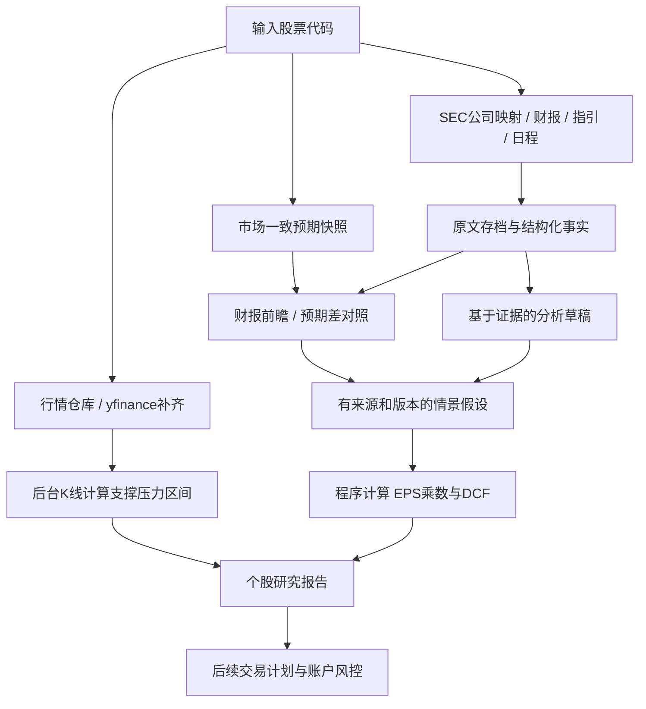

# 个股研究模块：行情、技术结构、财报前瞻、管理层指引与估值

2026-11-03用户进一步授权把手工基本面估值与技术区间结合，已实现每区间独立基本面配合四态、共同交集与研究共振。原技术强弱不改，未来目标不直接当现价支撑，缺时点/币种/折算输入保持资料不足；不改策略/退出/回测。当前规范见[结合专题](31-fundamental-technical-confluence.md)及FT清单，财报/电话会议自动链路继续停用。

2026-11-03最终范围覆盖下文自动财务研究：财报/电话会议/预期/网站简析不再自动读取，财务输入由本人问GPT核对后录入。程序仍算EPS×PE、DCF和基于日线的技术支撑压力；第二模块不变。当前实现、manual-valuation-v1与MV清单见[手工财务研究](30-manual-valuation-input.md)，下文自动抓取/原文分析为停用历史。

2026-11-03用户最新需求：停用DeepSeek原文分析，改为读取公开网站/机构简析，逐条附出处，来源缺失或只有标题明确标注；原文与旧分析不删除。下文自动AI分析要求已停用。当前[公开简析](29-external-briefs.md)、[中文报表/独立估值](28-research-console-report.md)及新RS/BR清单优先，未运行新版验收。

版本：v0.3；更新日期：2026-10-24；状态：已加入首版代码，未运行测试；实现边界见 [交付说明](10-research-implementation.md)。

本专题细化UNI-02/04与STR-04。用户最新要求：近一年K线仅在后台获取与缓存，不在前端绘图；缺失时通过yfinance获取；多因素支撑压力分析；获取并保存财报与业绩附件；纳入财报前瞻与管理层指引；用EPS与DCF研究一年估值情景。2026-10-24随后取消电话会议获取，电话会不再作为必需材料，见RESEARCH-04。

本模块可以先独立实现和使用，不必等待账户、券商和全部交易模块完成。它输出可追溯的研究结果；“可研究”不等于“满足账户开仓条件”。后续接入计划模块仍须通过全局风控。

产品顺序：本专题为第一模块，后接 [第二模块：趋势、策略与观察池](08-trend-strategy-module.md)。本模块提供行情、指标、已确认价格结构与研究证据；正式三态趋势/判断状态由第二模块唯一分类器产生，第一模块若展示该标签则复用结果，不重新实现。

## 1. 流程与输出

研究页固定回答：现在处于什么技术结构、公司业绩与预期有什么变化、未来有哪些关键条件、不同假设对应什么估值、哪些材料尚未取得。不能把技术支撑、估值区间和账户止损合成一个价格。

## 2. RESEARCH-01 行情附带口径与缓存

按用户最新要求取消独立身份/公司简介查询：输入代码建立内部证券ID后直接获取日线，币种、时区和证券类型只读取行情响应已有字段，不调用get_info。SEC公司/CIK映射仅用于披露获取，不作为行情前置请求。仍不依赖ticker字符串作为永久主键；未知字段不猜测，同名代码、股份类别、ADR比例及更名存在歧义时保留待核对。ETF不套公司EPS/DCF。

后台至少覆盖近一年日线，计算层独立配置历史长度，建议模板预取约3年，以提供均线预热、较长周期结构和历史参照；上市历史不足时使用实际可用历史并标记，不补造K线。前端展示技术指标、支撑压力区间、证据与数据状态，不展示K线图。

行情读取流程：

1. 查自建持久化行情仓库，检查请求范围覆盖、交易日完整性、数据版本和最后完整交易日。
2. 命中且满足新鲜度要求时直接返回，不为重复打开页面反复请求上游。
3. 缺失时通过行情适配器调用 yfinance，补齐缺口并复核配置的近期重叠窗口，保存来源响应、规范化OHLCV、分红拆股信息与校验状态。
4. 有旧缓存但过期时，可先展示明确标注的旧技术结果，更新请求通过去重任务处理；旧数据不获得新的“已更新”时间，也不生成可执行的新信号。
5. 新数据成功校验后发布新快照，重算受影响指标；失败保留旧数据和错误状态，不用空结果覆盖有效历史。

yfinance 的文档所述持久缓存主要是时区与 cookie，不能代替本系统的行情仓库。行情来源适配层应可更换，第一版使用 yf 不代表它是所有数据的唯一来源。

缓存键至少区分证券、周期、交易时段、来源、价格调整口径与数据版本。图表最近一年只是查询范围，不应为每次滑动窗口重复保存一份整段行情。

价格调整选项必须显式传递，不能依赖库默认值。保存供应商返回的OHLCV及其确切调整语义、企业行动和调整因子；不能把字段名 Close 或 auto_adjust=False 直接宣称为完全原始历史成交价。拆股/分红会影响旧价格序列，发现企业行动或来源修订时重建受影响区间及派生缓存，并保留前一版本。

盘中未完成的日K与完整收盘K线分开标记。日期使用交易所时区与日历；周末不是缺失交易日。限流和临时错误使用退避及短期失败缓存；同一证券并发请求合并，避免请求风暴。

## 3. RESEARCH-02 多因素支撑与压力

以 UNI-04 的已确认价格结构为主体，多因素用于解释和排序，第一版不堆砌大量重复指标。

| 因素族 | 用途 | 约束 |
| --- | --- | --- |
| 结构位置 | 已确认高低点、盘整区边界、过去突破/回踩区 | 必须保存确认时点，不能使用未来K线 |
| 趋势背景 | 配置的短/中/长期均线位置和斜率 | 均线是动态参考，不等于必然支撑 |
| 量价验证 | 接触区间或突破日的量能、收盘位置、后续保持情况 | 日成交量不能冒充真实分价成交分布 |
| 波动尺度 | ATR归一化区间宽度、距离和失效缓冲 | 防止不同价格/波动股票使用同一美元阈值 |
| 时效与有效性 | 最近接触、独立测试次数、最近突破/跌破 | 同一连续震荡段不能无限累计确认次数 |

算法先形成候选区间，再按配置的因素族权重排序和合并。相近均线/高低点共振可说明，但不能将同源高度相关信号当成多个独立成功概率。评分名为“证据强度/结构评分”，没有校准验证前不得显示“反弹成功率80%”。

每个区间显示上下界、离现价的距离、来源点、确认时间、支持因素、反对因素、测试/突破状态和失效条件。方向反转需按配置的收盘确认/回踩条件更新；画出的区间不自动转成买入指令。

用户随后要求“强支撑/一般支撑/弱支撑”及相应压力标签。`config/technical-strength.json`配置当前模板：一般分数40、强分数60；强结构另需至少3次独立接触、最近角色确认不超过63个交易日，以及均线重合或拐点平均量/当前20日均量至少1.2。它们不是经回测校准的概率。角色转换后须在最近重新上穿上界后有已确认低点，压力反之；缺少回踩/反抽时显示“待确认支撑/压力”，即使分数高也不升级。收盘在区间内部显示“现价区间，方向待确认”。保存`strength_reasons`和`weakness_reasons`。

行情有效但技术参数变化时，普通刷新基于缓存日线重算技术结构、保存新版本，行情原取得时间不变；`--cached`不重算，旧技术标记`stale`。没有足够上方结构时不补造压力。

第一版不从一年日线伪造筹码分布或精确 Volume Profile；若以后增加分时数据，需明确数据覆盖和近似方法。全时历史中无法确认的支撑/压力显示未知。

## 4. RESEARCH-03 财报与材料获取

采用“程序获取并存档，模型基于材料分析”的分工。模型可以辅助发现公司IR链接或定位段落，但被采用的数据必须回到可获取的原始资料；不能使用模型记忆当作最新财报。

| 材料 | 优先来源 | 用途 |
| --- | --- | --- |
| 定期财报与结构化指标 | SEC EDGAR、公司投资者关系网站 | 三张财务报表、附注、风险与管理层讨论 |
| 最新业绩发布稿、演示稿、财务补充 | 公司IR及相关公开附件 | 财报刚发布但定期申报/XBRL尚未齐全时补充最新信息 |
| 财报发布时间 | 公司确认日期优先，日程数据商辅助 | 前瞻报告和事件窗口；区分已确认/估计日期 |
| 管理层指引 | 公司官方发布稿、演示稿、财务补充或正式披露中的明确展望 | 营收、利润率、EPS、资本支出等前瞻；已实现业绩、分析师预测、通用免责声明均不能替代 |
| 分析师一致预期 | 可获得且允许使用的数据提供方 | 财报前预期、分歧和修订；不是SEC数据字段 |
| 电话会议 | 已取消自动获取；已有或手工导入档案可保留 | 非必需材料，不列为缺失或阻塞项 |

2026-10-24用户将默认范围收缩为最近两期财报，替代此前8季/多年模板。用`FINANCIAL_REPORT_COUNT=2`配置，按财报期选择10-Q/10-K（外国发行人20-F/40-F）及对应修订，不把两份任意8-K/6-K当作两期财报。原报告和最新修订属于同一期；结构化财务明细只选对应期末日，保留单季/累计/年度/时点的不同口径。近期IPO或覆盖不足时如实展示。

SEC companyfacts是批量接口，底层原始响应仍完整归档；对外研究快照及AI结构化输入只取选中期间。原文中的历史比较数字不删改；已保存旧档案不删除，默认AI不再读取旧期定期报告和既有8-K封面。手工指定资料ID可显式分析其他档案。只取两期不保证可计算完整TTM、同比序列或长期DCF假设，需要额外数据时明确缺口，不默默扩大抓取范围。

“最新”按公司财务期间、披露/修订时间和材料类型判断，不简单选择文件列表最后一条；一份旧季度的修订稿不等于新季度业绩。美国本土公司与外国发行人适用材料不同，不要求所有公司每季一定有10-Q。

SEC companyfacts 提供结构化标准概念，但不能假设它包含每个公司自定义KPI、全部分部指标、non-GAAP调节表或电话会全文；必要时解析原文或进入待核对。

## 5. RESEARCH-04 取消电话会议自动获取

用户最新取消电话会议获取。普通刷新不扫描发布稿中的转录链接、不请求第三方电话会目录/正文、不处理音频；电话会缺失不发警告、不计为待补项、不阻塞研究。`data_status.calls=disabled`，覆盖信息标记`calls_required=false`。

已有电话会档案不删除；用户主动导入的材料仍可按真实来源与证据分析，但不得补造正文或问答。仅在实际提供相应材料时做电话会分析，不要求建立新的电话会研究页。

管理层指引独立处理：优先使用公司官方业绩发布稿、演示材料或财务补充中的明确经营展望。当前自动获取仅覆盖SEC业绩EX-99附件，尚无通用公司IR抓取器；独立IR材料可手工导入。关键词提取是待核对草稿，显式AI分析也只是带证据的草稿，需核对目标期间、指标、单位、上下限、GAAP/non-GAAP及前提条件后才能确认。区间、同比增长、定性展望分别保留，不自动互相换算。

材料中没有指引时标记“已获取材料中未取得”，不能断言公司从未披露或已撤回指引。分析师一致预期、历史已实现数据、通用前瞻免责声明和模型假设均不作为管理层经营指引。若指引仅在电话会披露，本轮保持未取得。

## 6. RESEARCH-05 财报前瞻与预期快照

“前瞻”同时覆盖两类：财报公布前的市场/公司预期，以及财报公布时管理层对未来季度/年度的指引，不能混为一栏。

财报前报告包含：预计公布时间及确认状态、本次报告期间、上次管理层指引、当前一致预期、可用的预期修订轨迹、预期分布/分析师覆盖、关键业务KPI、仍需核对的经营问题、情景触发条件。

每条预期保存：来源、快照时间、预测期间、币种、单位、GAAP/non-GAAP、basic/diluted、平均/中位/区间含义及覆盖数量（来源没有则未知）。当来源只提供财年预期时，不将其直接写成未来12个月预期。

财报发布前冻结一个带截止时点的比较快照。已发布后下载到的“当前一致预期”不能回填为财报前预期。无法获得历史预期快照时，仍可做当前前瞻，但历史预期差标记不可计算。

yfinance分析师估计接口可作为第一版候选数据源，经适配器验证实际覆盖和口径后使用；不能假定它提供完整历史一致预期、所有公司或所有业务KPI。

## 7. RESEARCH-06 财报后：实际、旧指引、预期、新指引

分别比较，不能用一句“超预期”替代：

1. 本期实际与同期间、同口径的财报前市场预期。
2. 本期实际与此前针对本期的管理层指引。
3. 新的下季/全年指引与之前对同一目标期间的指引，以及同期间市场预期。
4. 官方原文披露的变化是否支持原有长期逻辑，是否引入新的反对证据。

实际EPS超预期但未来指引下降时，两项同时突出，不能互相抵消成一个模糊分数。指引没有给出不等于维持不变。已完成季度从全年指引中扣除推导余下期间时需保留公式与财务期间，不能混用累计和单季数值。

EPS预期接近零/为负时，以绝对差和单位展示，不输出误导性的巨大“超预期百分比”。缺少可比数据则显示不可比及原因。

业绩发布稿、电话会、正式财报和更正资料可能先后到达：允许生成阶段性报告，展示已覆盖材料和待补部分；每次新增证据创建新报告版本，不能提前声称所有材料已齐。

## 8. RESEARCH-07 财务数据规范化

财务字段必须保留期间起止、期间类型、财年、披露时点、币种、计量单位、来源概念、报告版本和审计/初步状态。GAAP与non-GAAP、基本与稀释EPS分别存储，non-GAAP有调节来源；不得无提示混算。

单季、累计、年度、TTM分别标识。重建单季需采用同口径累计差额；EPS与加权平均股数的期间关系单独处理，不把累计EPS逐条求和。拆股、ADR比例、股份类别、一次性项目和稀释需明确转换。

源数据、规范化数据、人工修正和预测假设分层。自动单位/报表关系校验发现冲突时，保留原值、原因和待核对状态，不能静默挑选更有利于估值的数字。

基础检查包括单位数量级、重复财报、期间重叠、EPS/净利润/加权股数关系、现金流与现金余额的可解释差异。公司特殊口径不能被简单恒等式误判，差异需人工核对而非强行凑平。

## 9. RESEARCH-08 EPS与估值倍数情景

EPS本身不构成价格估值，需要与可解释的估值倍数相乘。输出保守/基准/乐观情景，分别保存营收增长、利润率、净利润、稀释股数、EPS、倍数及其依据。

必须区分：

- 当前估值：当前TTM EPS×对应的历史口径倍数，或当前NTM EPS×对应的前瞻倍数。
- 12个月目标时点H的情景估值：H时点的预测TTM EPS×H时点假设的TTM倍数；若选择H时点前瞻倍数，则需要H之后12个月的EPS预测。

不能把“今天预测的未来12个月EPS×今天的前瞻PE”直接标记为严格的“一年后价格预测”，也不能把FY1估计无换算当作NTM。

“一年范围”在本模块定义为12个月目标时点的不同假设估值情景，不是未来一年实际交易价格的最高/最低包络。EPS或DCF本身不能给出这一年必定覆盖的价格上下限；界面必须明确这一点。

倍数依据可来自当时可获得的公司历史区间、可比公司与增长/盈利质量假设；保存样本、期间、口径和人为调整理由。不能为了让当前股价看起来便宜而调高目标倍数。

EPS非正、极接近零、严重周期失真或缺少可靠预测时，PE法标记不适用/低可靠度；其他估值法另选适用模板，不返回零价格或硬套正倍数。情景价格不是统计置信区间，没有验证过的概率模型不标90%覆盖等概率。

## 10. RESEARCH-09 DCF与一年目标时点

第一版针对适用的非金融经营公司采用明确的FCFF框架，由程序计算：

- FCFF = EBIT×(1−税率) + 折旧摊销 − 资本开支 − 营运资本增加。
- 经营资产价值 = 预测期FCFF折现值之和 + 终值折现值。
- 持续经营终值 TV_n = FCFF_(n+1)/(WACC−g)，要求 WACC>g，稳定期增长与再投资假设一致。
- 普通股权益价值 = 经营资产价值 + 适用的非经营资产 − 债务 − 少数股东权益/其他优先索取权；再按明确的股数与潜在稀释政策计算每股价值。

现金流、折现率、币种、名义/实际口径必须匹配；不能将现金流表里的 CFO−CapEx 不加分析就当FCFF。现金、利息、期权和股票薪酬处理要有一致政策，避免漏计成本或将同一稀释影响重复扣除。

预测期、收入/利润率、税率、资本开支、营运资本、再投资、WACC、长期增长率、债务现金与股数路径均可配置并带来源。模型可提出假设草稿，不能把猜测写成财报事实。对银行、保险等不适用公司标为待适用模型，ETF不运行公司DCF。

用户随后要求普通研究直接产出PE/EPS/DCF草稿，已增加确定性生成步骤，详见[自动估值草稿](13-valuation-drafts.md)。只复用已归档SEC批量数据中的补充历史构造TTM，不扩大最近两期正文/研究事实范围；历史PE按披露日期匹配。增长和经营路径是明确的机械假设，WACC必须有来源，结果始终未确认，不作为可靠价格预测。自动草稿不调用AI，用户仍可用独立完整假设计算。

同时输出两个独立结果：

1. 以当前时点折现的内在价值情景范围。
2. 如需12个月目标时点价值，在H时点重新折现其后现金流，并使用H时点预测现金、债务、股数等状态；不能把今日价值直接改标题，也不能只乘一个收益率滚动过去。

展示WACC/长期增长率及关键经营假设的敏感性、终值占比和输入完整度。终值占比高意味着依赖远期假设，不能凭更多小数位制造确定感。模型不稳定时返回无法可靠估值和缺失项。

## 11. RESEARCH-10 研究结论的合并方式

研究报告并列显示技术区间、EPS情景、DCF情景、财报前瞻与管理层指引变化，不默认将几种价格平均为一个“精准买入价”。两种估值分歧大时解释增长、倍数、现金流、折现率或口径差异。

低于估值情景范围但技术趋势仍下降时，显示“估值可能有吸引力，入场条件未确认”；接近支撑但未来指引/现金流恶化时显示逻辑风险；已有长期持仓基本面仍有效时，不因小额浮盈自动提示卖出。

输出数据可靠度、模型适用性与假设敏感度三个维度，不能混成未经校准的成功概率。材料缺失不阻止其他已完成部分显示，但相关结论必须降级。

## 12. RESEARCH-11 持久化与派生缓存

用户随后明确取消财报时间过期：结构化财务、披露索引、财报正文与业绩附件持久保存。普通查询在档案完整、范围和版本一致时直接复用，不因24小时到期请求来源；`DISCLOSURE_CACHE_HOURS`仅控制预期、日程、EPS修订/趋势等动态资料。首次无记录、原件/正文缺失、范围/版本变化或显式`--force`手动同步时可获取；同来源、期间及申报版本的原件已有则不重复下载，丢失文件可补回。

未来财报日历发现新一期发布/修订时，按证券、期间、来源申报ID/版本追加原文和结构化快照，更新默认最近两期视图并使依赖的估值/分析过期，旧档案不覆盖。日历只是触发依据，预计发布不等于已取得新报，需要来源实际提供资料。该事件接口本轮未接入，普通查询不轮询新财报。永久存档不等于已确认最新一期，也不取消估值对过旧财务基线的适用性限制。

财报、可获准保存的电话会材料、演示稿属于研究档案，不是过期就删除的临时缓存。保存原文件/文本、来源URL、文档哈希、披露/取得时间、财务期间、版本、解析结果与原文定位。来源有保存限制时保存允许范围与引用信息，不能声称已存完整原文。

PostgreSQL保存规范化行情、财务事实、预期/指引快照、元数据和任务；原始文档存可备份的文件/对象存储。第一版无需为了缓存额外引入Redis。

至少增加以下实体：research_requests、source_documents、document_versions、call_segments、guidance_facts、consensus_snapshots、earnings_events、valuation_assumption_sets、valuation_runs、research_report_versions；复用已有行情、证券、财务、证据、任务和审计实体。

估值、技术等确定性派生结果的缓存包含其数据、时点、算法和假设版本。用户最新将DeepSeek财报分析改为永久按原文版本复用：首次取得完整财报且无对应分析、新财报或修订/补充原文版本未被分析覆盖时才调用；仅行情、预期、日程、估值假设、模型/提示/token配置改变均不重跑已完成分析。旧草稿的预期仍属当时快照，当前预期单独显示。分析失败只允许手动继续，普通查询/重启不重复付费。

财报获取、归档及按版本分析共用`financial_reports.process_financial_reports`，命令行和网页已接入，未来日历在实际发布/修订后使用同一方法同步。仅预计日期变化不触发；同版本重复通知不重复分析；`force`只同步来源，不强制AI。旧分析兼容复用，详见[公共方法与生命周期](15-financial-report-lifecycle.md)。

数据修订保留旧版本和关联报告，历史回放使用当时可知版本。历史报告显示当时数据，最新报告显示当前数据，不能混成同一份。

## 13. RESEARCH-12 展示与模块级工作方式

输入代码后按模块渐进显示：缓存/价格状态 → 技术结构 → 财务与事件资料覆盖 → 前瞻/管理层指引 → 估值情景。每块显示可用/更新中/过期/缺失/失败和数据时点，不让慢速原文下载阻塞其他已取得信息。

页面内容：

- 后台行情覆盖与缓存状态、支撑压力区域、均线/波动及技术条件；不绘制K线。
- 最新业绩、上次指引、当前预期、下次财报日与来源。
- 管理层经营展望、关键引文定位和有可比证据的指引变化；电话会不作为必需材料。
- 保守/基准/乐观估值及参数编辑，明确当前价值还是12个月目标时点。
- 支持持有/买入研究的证据、反对证据、缺失材料、下一验证事件。
- 保存报告、加入观察池、将已核实研究传给计划草稿；不直接下单。

此模块默认可在未设置账户本金/币种的情况下研究证券自身报价币种的价值；账户级仓位和交易许可在账户设置完整后另行评估。

2026-10-24用户补充命令行核对需求：支持输入股票代码直接输出研究数据，无需启动网页服务。命令行与网页共用数据获取、缓存与计算；按最新规则，已配置DeepSeek时首次/新财报版本可自动分析，其他查询复用本地；`--analyze`可手动继续未完成分析，同版本完成结果仍复用。输出保留数据时点、来源、证据与缺失状态，支持完整JSON导出；不以报告生成时间冒充数据更新时间。

## 14. 模块配置

| 配置组 | 主要字段 | 默认建议/边界 |
| --- | --- | --- |
| research.market | minimum_history、history_fetch_depth、interval | 至少覆盖近一年；计算历史模板约3年，不在前端绘图 |
| research.market_cache | max_age、overlap_refresh_sessions、adjustment_policy、repair_policy | 显式价格口径；修复保留痕迹；按交易日判断完整度 |
| research.sources | price/filings/consensus/calendar提供方与优先级 | yf行情；SEC附件为当前自动原文来源，独立IR材料可导入；预期不假定免费全覆盖 |
| research.documents | report_count、refresh_schedule、retention | 当前默认最近2期；档案持久保留且可备份，修订按同一期处理 |
| research.technical | factor_weights、zone_merge_tolerance、confirmation、distance_limits | 复用UNI-04参数，不另写一套矛盾的结构算法 |
| research.earnings | preview_window、snapshot_cutoff、event_policy、comparison_basis | 日期确认状态、财报前冻结快照、同口径比较 |
| research.calls | 当前已取消自动获取，不新增启用配置 | 既有和手工导入档案保留，不计为必需材料 |
| valuation.eps | horizon、eps_basis、multiple_basis、scenarios、comparables | 明确TTM/NTM和目标时点；不适用不强算 |
| valuation.dcf | forecast_years、cashflow_type、WACC、terminal_growth、operating_assumptions | 第一版FCFF；约束WACC>g及股权桥接一致性 |
| valuation.analysis | sensitivity_ranges、evidence_required、review_status | 假设草稿可试算；未核实结论不能自动激活交易 |

## 15. 验收

| 编号 | 场景与预期 | 规则 |
| --- | --- | --- |
| F01 | 最新完整行情缓存命中时不请求yf；缺失只补数据；旧缓存展示过期且不会生成新的合规入场；来源失败不清空有效历史 | RESEARCH-01 |
| F02 | 展示一年但计算使用足够历史；新股历史不足提示；拆股/分红及来源修订使相关区间重算；未完成日K不用于收盘信号 | RESEARCH-01/02 |
| F03 | 支撑压力为区间且可追溯确认时点；多个相关指标不伪装成功概率；无分时数据不显示真实分价筹码 | RESEARCH-02 |
| F04 | 发布稿先于10-Q到达时显示阶段性最新业绩；原文、期间、修订和解析均可追溯；旧期修订不被当作新季度 | RESEARCH-03/07/11 |
| F05 | 普通刷新不扫描或下载电话会、不调用转录提供方；calls状态为disabled、不产生缺失警告；旧档案保留且模型不得补造发言 | RESEARCH-04 |
| F06 | 财报前预期快照与财报后修订隔离；没有历史预期时不计算虚假beat/miss；GAAP/non-GAAP、FY/NTM混用被阻止 | RESEARCH-05/06/07 |
| F07 | 本期EPS超预期且未来指引下调，两项分别展示；撤回指引不显示为维持；指引附原文证据，分析师预测或免责声明不能代替；材料未取得不宣称公司未披露 | RESEARCH-04/06 |
| F08 | EPS为负或近零时不强算PE价格；目标时点与EPS/倍数口径不一致时拒绝估值或要求修正 | RESEARCH-08 |
| F09 | WACC≤g、币种/现金流口径混用、债务/现金重复计入、关键股数未知时阻止DCF正式结果；敏感性与终值占比可见 | RESEARCH-09 |
| F10 | 今日DCF与一年目标DCF分别标识；不能仅改标题；两种估值分歧显示原因，不默认取平均 | RESEARCH-08/09/10 |
| F11 | 新财报版本使对应分析待更新；假设变化只影响相应估值，行情/预期/模型参数不重跑已完成AI；旧报告能按旧证据重放 | RESEARCH-11 |
| F12 | 业绩附件任务失败不阻止已有技术区间/缓存信息显示；前端没有K线图；ETF进入适用研究流程；未设账户也可研究，但没有账户风控通过结论 | RESEARCH-01/10/12 |
| F13 | 用户运行 `stock-research AAPL` 输出研究数据，无需网页服务；首次/新财报可分析，重复查询同版本不调用AI；命令行与网页共用财报公共方法及数据库 | RESEARCH-01/11/12 |
| F14 | `--cached`不请求外部来源/模型；来源部分失败仍输出已有数据和警告；原文/预期/估值假设缺失时保留未知，不编造电话会或目标价 | RESEARCH-01/04/05/08/09/12 |
| F15 | JSON包含全部已保存财务明细与证据；文本截取明细明确显示数量；导出不覆盖旧文件；仅首次/新财报版本分析，`--analyze`同版本仍复用；失败不自动重试收费 | RESEARCH-11/12 |
| F16 | 命令日志实时输出控制台stderr，包含时间/级别、步骤进度、缓存、耗时、完成/失败；JSON报告保持stdout或单独导出，日志不包含密钥或完整请求正文 | RESEARCH-11/12 |
| F17 | 默认只选最近2个定期财报期间，8-K不占财报名额；老季度修订不冒充新期；事实只包含选中期末日，单季/累计分开；原文旧档案仍保留，范围改变使缓存重评 | RESEARCH-03/07/11 |
| F18 | JSON的data_status区分取得数据、缺失、需确认、未生成与不适用；研究范围另列research_scope；来源异常保留error_type及可得HTTP状态码，不因取得SEC部分就宣称研究完成 | RESEARCH-01/03/12 |
| F19 | 日线请求不经过get_info；只使用日线自带元数据，缺少币种不默认为USD；Yahoo限流明确分类并冷却，force不绕过供应商限制 | RESEARCH-01/11 |
| F20 | EPS、日程、修订、趋势各自保存；主预期失败不以程序异常阻止其他组件，提供方冷却时逐项说明；失败不清空既有快照 | RESEARCH-05/11 |
| F21 | 最近两期业绩8-K沿EX-99归档真实附件，不扫描转录；旧材料快照因策略版本变化重评，不复用旧电话会缺失警告；关键词指引仅为带证据草稿 | RESEARCH-03/04/06 |
| F22 | 命令行资料/事件/指引/估值复用网页规则；已公布事件不得冻结；未确认假设只生成明确草稿，不产生正式目标价或交易许可；用户估值上下文不能覆盖已知ETF或冲突币种 | RESEARCH-05/07/08/09 |
| F23 | 普通研究生成未确认PE/EPS/DCF草稿，完整保存假设与补充证据；两季不直接年化，历史PE不用未来盈利；无匹配WACC保留DCF缺口；cached不重算，输入/配置变化标记旧草稿 | RESEARCH-07/08/09/11 |
| F24 | 强/一般/弱支撑压力依据及限制可追溯，角色转换未确认不升级；现价区间方向待确认，无上方结构不补造压力；参数变化仅重算有效缓存，保留行情取得时间 | RESEARCH-01/02/11 |
| F25 | 完整存档的财报/财务/附件不因时间重新获取；动态预期保留独立TTL；同版本人工同步复用原件，缺失可修复；修订留旧版，未来由发布事件写入新财报，未接入时不声称已自动更新 | RESEARCH-03/11 |
| F26 | 命令行、网页与未来发布事件共用财报入口；仅预计日期变化不触发AI；重复同版本发布复用结果；旧分析无需付费迁移；动态信息变更单独提示 | RESEARCH-11/12 |

## 16. 查阅依据

- [yfinance PriceHistory](https://ranaroussi.github.io/yfinance/reference/yfinance.price_history.html)：历史行情接口、周期、调整与修复选项。
- [yfinance缓存说明](https://ranaroussi.github.io/yfinance/advanced/caching.html)：文档所述持久缓存包括时区和cookie，本模块另建行情仓库。
- [yfinance价格调整说明](https://ranaroussi.github.io/yfinance/advanced/price_adjustment.html)：价格调整语义需与接口参数、来源字段共同核对，不凭字段名猜测原始价。
- [yfinance Ticker](https://ranaroussi.github.io/yfinance/reference/api/yfinance.Ticker.html)：可用估计接口及其期间字段，实际覆盖需验证。
- [SEC EDGAR公开API](https://www.sec.gov/search-filings/edgar-application-programming-interfaces)：公开提交历史、标准XBRL概念、单位与期间处理。
- [公司IR电话会文本示例](https://investor.nvidia.com/files/content_files/TRANSCRIPT_-NVIDIA-Corp-NVDA-US-Q2-2027-Earnings-Call-26-August-2026-5_00-PM-ET.pdf)：正文/Q&A、发言人和更正版本的实际材料形态；不意味着所有公司都有相同免费覆盖。
- [Damodaran：终值](https://pages.stern.nyu.edu/~adamodar/New_Home_Page/littlebook/terminalvalue.htm)：现金流与折现率一致、终值敏感性和增长约束。
- [Damodaran：从企业价值到每股权益价值](https://pages.stern.nyu.edu/adamodar/New_Home_Page/littlebook/valuepershare.htm)：现金、债务及其他权益索取权需要按模型一致处理。

以上资料支持接口与方法的基本事实；参数模板、情景路径和策略有效性仍需实际验证。
