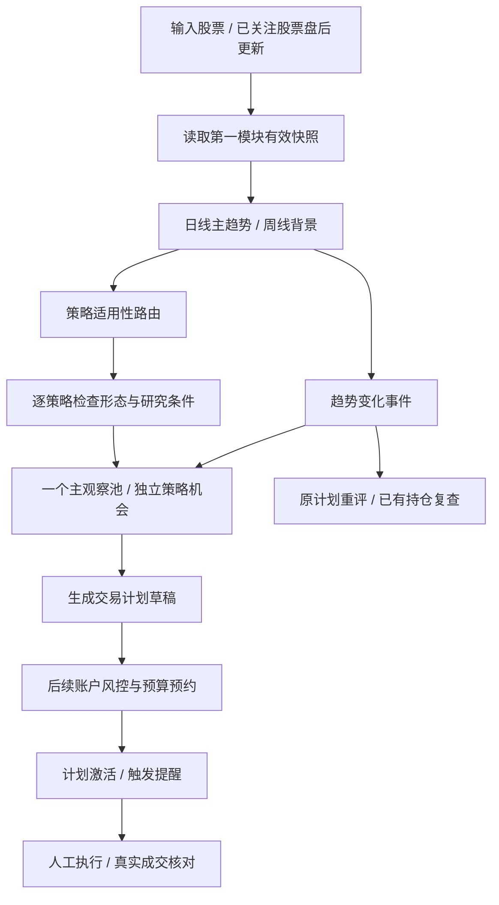

# 第二模块：趋势识别、策略适配与动态观察池

2026-10-31新增独立stock-notify编排：当前买点交第一模块研究后发飞书群，退出/预警变化直接优先推送，普通scan仍不研究/发送。仅日线技术提示，未接真实持仓或自动下单，未设定时任务。命令/凭据/幂等/失败和NF用户核对见[群推送](27-signal-research-feishu.md)；本轮未运行测试或实际投递。

2026-10-30最终退出增量：两套买点已改为共用冻结保护线＋红带/EMA5低于EMA10/MACD偏空三项现态确认，反包退级或撤销。旧版退出完全注释存档，不同时执行。预警层级变化、确认退出及档案已接CLI/股票池；当前规则与CEX用户验收见[共同退出](23-common-exit.md)。未运行测试。

2026-10-30退出增量：用户授权增加两策略的技术退出提示，完整交易流程留待资金管理和回测。共享计算、CLI、股票池历史已接入，规则和E01—E11验收见[技术退出](22-strategy-exits.md)。原买点规则不变，退出不生成真实成交，本轮未运行测试。

2026-10-30最新增量：按用户指定MG7建立可增删自选池，复用两套独立策略扫描，保存结果和去重信号历史。命令、配置和W01—W10用户核对见[股票池批量扫描](21-watchlist-scan.md)。本次仅手动关注和技术信号档案，不等于本文完整自动入池、机会生命周期、交易计划或持仓联动已实现。历史记录不冒充当前机会；未运行测试，由用户测试。

2026-10-29最新增量：正式接入独立MACD12/26/9图标1买入提示，与EMA回踩分别计算、默认同时启用。原图标1出现即在当日收盘提示买入，不附加其他策略条件；历史色带关系仅作上下文。完整说明与验收清单见[独立箭头策略](20-macd-reversal-discussion.md)，本轮未运行集成验证。

版本：v0.7；更新日期：2026-10-30；状态：已实现趋势判断、两套独立策略和MG7最小自选池。[EMA20回踩买点](19-ema20-pullback.md)高点当天须绿带，连续红带最多5根，第6根起取消旧上涨资格；严格次日开盘/收盘确认。本次未运行验收；完整账户/持仓与机会生命周期仍为设计，未验证策略收益。

用户已确认：输入股票判断上涨/震荡/下降，按趋势匹配策略，匹配机会进入观察池，趋势变化后持续重新评估。本模块接在 [第一模块：个股研究](07-stock-research-module.md) 后，向后续交易计划与账户风控提供机会草稿。

2026-10-24最新开发范围仅趋势判断及独立命令行。用户进一步指定：仅用2026年数据，1—2月预热、3月起逐根判断并显示连续趋势区间。为避免SMA200在3月无足够历史，历史命令默认使用单独的SMA20/30短样本模板，周线40根不足仍为未知；标准当前模板SMA50/200保留。所有数值可配置，短样本结论不冒充长期趋势。确认日不回填，候选/未知区间不被未来数据改写。

2026-10-26用户要求小步实现、逐步自行验证。策略部分目前仅新增STR-01趋势前置检查：`stock-trend --method futu-macd --start ... --strategy-check`，输出PASS/WAIT/FAIL/UNKNOWN；不判断完整适用性、形态或买卖许可，不创建观察池记录。详见[策略增量第一步](18-strategy-trend-gate.md)，尚未运行验收。

随后用户明确简化流程，选择原始绿/红色带直接路由买点；最终先确认EMA20回调方向。旧前置门槛退出当前CLI路径，`--strategies`默认只启用绿带EMA20回调。以下完整模块设计中要求主趋势确认、周线背景等的条件，暂不作为这一技术买点算法的前置过滤；账户/计划许可仍未实现，不能混为通过。新12/26/9公式仅[讨论存档](20-macd-reversal-discussion.md)，其他买点草稿默认关闭。

2026-10-27最新修订优先：该EMA策略要求所选高点当天为绿带，回踩及确认最多容忍5根连续红带，第6根起按下降处理；原上涨波段失效后，须在失效后重新形成上涨起点和绿带高点并通过原上涨条件，不能因短暂转绿复用旧高点。要求明确前期上涨及离均线距离、从高点回到EMA20附近，严格下一交易日开盘/收盘守住确认，不要求突破前高。具体参数、日期与输出以专题v5为准。本次为回踩策略趋势/资格，旧结构主趋势和原始色带仍分别保留。

## 1. 模块边界

第一模块提供行情、已确认的价格结构、基本面、财报前瞻与电话会证据；第二模块判断趋势、匹配策略、跟踪机会。二者共用数据和Python规则包，不独立抓取两套行情、计算两套支撑区间。

趋势分类、策略适用、策略形态满足、计划获准和真实成交是不同结论。允许研究一只股票但没有适用策略，也允许策略形态就绪但账户没有风险空间。研究/观察状态不占用资金，只有后续激活计划才预约预算。

本模块初期支持单股输入和观察池内股票的盘后批量更新；全市场自动扫描作为可配置扩展，不能把未扫描到的股票标为没有机会。

## 2. TREND-01 周期与数据要求

默认研究模板采用日线中期趋势为主判断，已完成周线为长期背景，周期和窗口可配置。盘中报价用于计划条件和风险监测，不能用未完成日K/周K悄悄替换盘后趋势。

只使用当时已确认的高低点、足够预热长度的均线及有效行情。日线聚合为周线须依交易所日历；周末未到不使用半根周线当确认值，节假日缩短交易周按日历完成。

评估保存证券、周期、截止时点、最后完整交易日、数据/配置/算法版本和覆盖质量。第一模块数据缺失时可以展示已有报告，但不能获得新的有效趋势判断。

## 3. TREND-02 三态趋势与判断状态

趋势枚举仅为 UP（上涨）、RANGE（震荡）、DOWN（下降）。判断状态另设 CONFIRMED（已确认）、PENDING（待确认）、INSUFFICIENT_DATA（数据不足）、STALE（数据过期）。没有可靠方向时 current_trend 可为空，不创建第四种交易趋势，也不把未知一律记为震荡。

每个周期分别保存 current_trend、candidate_trend、last_confirmed_trend、assessment_status、evidence_strength、reason_codes。历史趋势只能标为“上次确认”，不能在当前待确认时冒充仍然有效的已确认上涨。

待确认还必须保存独立`progress`阶段和具体未满足条件：区分短期上行/下行动能、向上/向下修复、上涨/下降形成中、动能减弱、均线偏向、震荡证据未齐及证据冲突。阶段由已有检查项派生，仅解释证据，不能替代三态确认或放行策略。阶段、阻塞条件改变须切分历史区间，不能把多种情况合成一个持续数周的笼统“待确认”。详细规则和用户旧版AAPL核对见[趋势命令第4.1及8节](16-trend-cli.md)。当前仅修复解释与展示，严格确认延迟和短窗口ER造成的保持中断仍是待讨论问题。

用户随后提供富途EMA10/20/9公式，明确“绿带偏上、红带偏下，震荡另判”。已增加独立可选`--method futu-macd`：输出`bias`与原公式四条件/FILTER信号，震荡保持未评估，不套用以下三族门槛，不冒充已完成三态策略路由。原三族方法仍为可选对照且暂保留默认。用户新方法和实际AAPL图见[富途指标专题](17-futu-macd.md)；尚未与富途同口径逐点对齐。

2026-10-25用户进一步要求优化短红带：富途方法新增独立主趋势/回踩层，原色带与信号不改。初始进入默认2根并取得可用保护位；上涨中的短红/下降中的短绿先进入受挑战观察。保护位和ATR缓冲冻结，不自然过期，只能随新确认结构收紧；收盘破坏立即失效，也可由持续反向色带、深度和连续价格确认共同触发反转。破坏后的原方向须收复门槛再确认。新增`CHALLENGED`表示富途方法背景方向受挑战，不等于三族CONFIRMED或策略获准。震荡、交易及账户风险尚未接入；新版未运行，由用户重跑，详见[第7节](17-futu-macd.md#7-主趋势与回踩反抽状态机2026-10-25未运行)。

初始分类器采用三族可解释证据：

| 证据族 | 上涨 | 震荡 | 下降 |
| --- | --- | --- | --- |
| 已确认结构 | 最近独立高点和低点均抬高，超过配置噪声容差 | 多次触及可识别上下边界，无持续单向推进 | 最近独立高点和低点均降低，超过噪声容差 |
| 均线方向与位置 | 中期斜率为正、价格/均线位置支持向上 | 斜率接近平坦，价格围绕均线与区间反复运行 | 中期斜率为负、价格/均线位置支持向下 |
| 持续性与波动 | 位移相对波动具有足够持续性 | 方向延续性低、边界仍有效 | 位移相对波动具有足够持续性 |

核心规则：先分别检验UP、DOWN的必要条件，再独立检验RANGE条件。结构、均线与持续性需按明确配置组合；第一版采用必要条件与证据明细，不用AI综合判断或不透明总分决定方向。多个分类同时满足或都不满足时为PENDING，并展示冲突项。

结构使用配置数量的已确认拐点，至少具备可比较的两个高点与两个低点；差异按ATR归一化。均线斜率定义为 (MA(t)−MA(t−k))/(k×ATR(t))，k>0、ATR>0；均线类型与窗口显式配置。持续性可使用方向效率 ER=abs(C(t)−C(t−n))/sum(abs(C(i)−C(i−1)))，分母为0时按无方向位移处理；ER只衡量持续性，不单独给方向。

震荡还须验证区间边界和触及次数，不能只因ER低或均线不满足上涨就认定震荡。所有阈值、窗口、逻辑组合和容差版本化；研究模板经过测试再启用，不能把本节方法宣称为已验证盈利策略。

evidence_strength表示证据完整度/一致程度，不是上涨概率。可选ADX仅辅助强弱，不能以ADX高就判为上涨；不因增加多个高度相关均线指标而伪造多份独立证据。

## 4. TREND-03 多周期背景与切换确认

日线与周线各自判断，不能强行合并成一个标签。界面示例：“日线上涨，周线下降；中期反弹，长期反转未确认”。

策略档案声明允许的主趋势和背景组合。核心趋势策略的默认研究模板阻止明确的长期下降背景；周线数据未知时保留研究但不视为背景已通过。用户可修改背景政策形成新版本；机动策略可研究逆长期趋势的修复，但仍需自身条件和总风险校验。

趋势变化先产生candidate_trend，连续完整评估时段满足确认次数及切换缓冲后才成为CONFIRMED，并记录有效起点。尚未确认期间展示PENDING和上次确认趋势；依赖明确趋势的新风险机会暂停推进。

保持/切换阈值采用配置的滞回区间，避免一根普通波动K线反复改标签。确认次数、最小保持时段可配置；结构明显失效时立即暂停相关新增风险机会，不为等待新趋势确认而继续使用旧买点。

账户风险、个股风险退出与重大基本面逻辑失效独立运行，不等待趋势切换确认。旧持仓的退出不能被观察池滞回机制推迟。

## 5. TREND-04 策略适用性路由

先判断证券类型、资金池类别、主趋势/背景组合与策略是否启用，输出APPLICABLE / NOT_APPLICABLE / UNKNOWN；这一步仅说明允许进一步研究，不代表形态已满足。

| 主趋势 | 核心策略候选 | 机动策略候选 | 当前无机会时 |
| --- | --- | --- | --- |
| UP | STR-01普通股回调；STR-02普通ETF回调，均需背景与研究条件 | 可配置的顺势波段留作扩展，本版不临时挪用左侧模板 | 保持观察，等待价格和结构 |
| RANGE | 不自动新增核心趋势仓；已有核心持仓按原计划管理 | STR-05区间波段 | 等待有效下沿企稳或新的结构 |
| DOWN | 不新增核心趋势仓，允许关注研究 | 已启用的STR-03左侧修复，需短期企稳与严格预算 | 保持观察，不因跌幅大强行配策略 |
| 待确认/数据不足/过期 | 暂停依赖趋势的新风险机会推进 | 同样不以未知趋势放行 | 展示缺失/冲突，保留减仓通道 |

第一版策略注册表为四个交易模板：STR-01、STR-02、STR-03、STR-05；STR-04是模板隔离与事件共用规则，不是第四个交易模板。突破回踩与额外顺势波段未来单独注册，默认不启用、不用名称代替具体规则。

明确分离：STR-03处理下降背景下的有限修复，STR-05处理已确认震荡区间，不能因名称都包含“波段”而共用不匹配的退出政策。策略优先级影响展示/后续选择，不自动决定真实买入。

## 6. TREND-05 逐策略机会评估

每个适用策略独立输出：背景是否满足、研究是否合格、形态是否形成、价格是否合理、事件限制、等待条件、失效条件和数据时点。可展示NO_SETUP、FORMING、READY、BLOCKED、INVALIDATED等检查结果，再映射为观察状态。

研究信息取第一模块证据快照：基本面严重破坏不能被技术上涨抵消，估值便宜不能豁免下降背景，财报临近按照已配置事件政策处理。ETF使用适用的基金档案。

READY表示该策略的研究与形态条件完整，可形成有价格/期限/退出规则的计划草稿；不包含账户可用资金、购买力与风险许可。没有账户设置仍可研究READY机会，但不能显示“风控通过，可以下单”。

价格超过最高接受区间时保持过热/等待或按策略失效，不因为排名靠前而上调最高买价。首笔后的补仓与再次入场也必须形成独立计划，不能复用一次READY作为无限加仓许可。

## 7. TREND-06 一个主观察池与独立机会

在当前单用户工作空间，主观察记录按security_id唯一。上涨/震荡/下降、策略类别和准备程度是动态筛选视图，不是三套独立存储表。

同一证券可有多个策略机会，每个机会拥有独立ID、策略/版本、适用资金池、结构依据、生命周期、观察起点、等待/失效条件及后续计划关联。多机会不是多份资金；后续计划阶段仍合并证券暴露并原子预约。

进入方式：

1. 用户手工关注：未命中策略也可保留，显示真实趋势与缺失条件。
2. 自动命中：策略适用且至少达到FORMING，满足基础可交易性后，按启用的自动入池政策新增或更新主观察记录。仅“上涨”不把整个市场加入观察池。
3. 已有持仓关联：持续跟踪，不因用户隐藏观察列表而停止持仓风险检查。

首次发现时间与策略机会开始时间分开保存。重复扫描不得重复建主记录/同一机会，不能每日重置“首次发现”制造早发现假象。

同一策略同一结构锚点的连续评估更新同一机会；上一机会明确失效/结束或出现新的结构机会时建立新episode并关联前序。参数修改使旧机会版本不可修改，新评估与旧记录明确关联，不覆盖历史判断。

## 8. TREND-07 观察状态与聚合

| 策略机会状态 | 含义 | 下一步 |
| --- | --- | --- |
| OBSERVING 观察中 | 已关注但尚未形成完整策略机会 | 等待结构或补研究 |
| PREPARING 准备中 | 背景适用，已有形态雏形，仍有必要条件未满足 | 展示具体等待条件 |
| SETUP_READY 条件就绪 | 研究与形态条件满足，可生成计划草稿 | 进入计划模块核算与激活 |
| BLOCKED 暂停 | 事件/数据/背景等阻塞，保留恢复可能 | 提示阻塞原因，恢复时重评 |
| EXPIRED 失效 | 机会失效或期限届满 | 保留历史，新机会建新episode |
| ARCHIVED 归档 | 用户移出或机会长期无效 | 保留历史和来源，不继续普通机会提醒 |

允许PREPARING/SETUP_READY退回较早状态或进入BLOCKED/EXPIRED，但必须记录原因。BLOCKED恢复不是自动下单，应按最新数据重评到相应状态。终结机会不修改为从未失效的新机会。

评估映射：NO_SETUP对应OBSERVING（仅已有手动关注/既有记录时保留），FORMING对应PREPARING，READY对应SETUP_READY，BLOCKED对应BLOCKED，INVALIDATED对应EXPIRED；ARCHIVED由明确归档政策或用户操作产生。

主观察记录的汇总状态是派生视图：存在有效SETUP_READY则显示条件就绪，否则按PREPARING、OBSERVING显示；仅剩阻塞机会则显示BLOCKED，全部终结则显示失效/归档。证券级关键行情故障/不可交易状态优先遮蔽所有有效性声明，非必要AI摘要失败不等同于全局数据失效。一个策略受阻不抹去另一个仍合规策略的结果，所有子机会状态可展开。

主趋势、机会状态、交易计划状态和持仓状态四者独立。例如股票可以日线上涨、核心机会准备中、另一个历史计划已成交、当前持仓待复查，不能压成一个“可以买”的布尔值。

## 9. TREND-08 趋势改变后的处理

每个变化事件保存旧/新判断、候选变化、确认时点、原因、数据/算法版本与受影响机会。

| 对象 | 处理 |
| --- | --- |
| 主观察记录 | 自动更新趋势标签和筛选视图，保留历史，不复制到另一个物理池 |
| 原策略机会 | 重新检查适用性/形态；不满足即暂停或失效，不自动改名为新策略 |
| 新策略机会 | 在新背景与条件满足时独立创建，不能继承旧策略的买价、风险或退出条件 |
| 尚未激活的计划草稿 | 标记待重评；不继续声称有效 |
| 已激活但未成交部分 | 失去原有效条件时停止相关触发提醒、失效剩余执行意向、释放对应预约；未来券商接入时须确认真实撤单后才能释放在途占用 |
| 已部分成交或已持仓 | 保留真实持仓及其风险占用，按原有效计划和当前全局风险重评；不机械全卖，不将失败波段改名成长线 |

第一版没有券商订单控制能力；“停用计划”不表示券商订单已撤销，相关提示必须明确。实际已成交记录始终优先入账，不能因为计划失效而丢弃迟到成交回报/导入。

## 10. TREND-09 与计划、持仓及提醒衔接

观察状态到SETUP_READY后仅允许生成DRAFT，之后遵循PLAN-01/02/03/04。生成草稿不自动激活；触发通知只来自已激活计划，不来自观察列表中的高分排名。

每个计划绑定opportunity_id、趋势快照和策略版本。候选状态变化、数据修订、配置切换须使相关计划重新评估，避免旧事件在新配置下仍被投递。当前全局风险优先于观察结果。

观察提醒默认盘后汇总，区分“新候选、条件就绪、趋势变化、机会失效”；只在状态变化时通知，并按配置去重/限制条数。盘中只执行既有计划条件、风险提醒和数据健康提醒。一次价格波动不能不断发“买点来了”。

保留全量历史变化以供复盘，通知只挑重要变化。人工已读、计划激活、提醒触发和实际成交分别记录。

## 11. TREND-10 配置与可重放

| 参数组 | 配置项 | 约束 |
| --- | --- | --- |
| trend.timeframes | primary、background、completed_bars_only | 主/背景周期明确，完整K线为必要条件 |
| trend.structure | pivot_count、pivot_windows、delta_tolerance_atr | 复用第一模块确认逻辑；不得读未来拐点 |
| trend.direction | ma_type/window、slope_lookback、up/down/flat_thresholds、price_position_tolerance | 参数有序且不自相矛盾；归一化分母有效 |
| trend.persistence | efficiency_window、directional_min、range_max | 明确持续性仅辅助，边界附近允许待确认 |
| trend.range | boundary_lookback、touch_count、touch_spacing、containment_requirement、breakout_tolerance | 独立区间证据；相邻K线不算无限独立触及 |
| trend.switching | confirmation_bars、hysteresis、minimum_dwell | 不延误保护性退出；改变配置不伪造过去已确认 |
| strategy.routing | enabled_strategy_ids、allowed_primary/background、security_types、book_scope、display_priority | 核心/机动、普通股/ETF分开；未实现策略不可启用 |
| watchlist | auto_add_matches、max_auto_items、ranking、inactive_expiry、pinned_policy | 排序和上限可调；手动关注/已有持仓不能无提示被自动挤出 |
| opportunities | episode_identity_policy、setup_expiry_sessions、recheck_schedule | 同一结构幂等，新机会保留前序引用 |
| notifications.watchlist | summary_schedule、change_types、cooldown、max_items | 区别普通机会消息与风险升级 |

这里细化已有trend和structure配置，不另设相互矛盾的第二套均线/区间参数。具体技术数值由研究模板与用户配置决定，不固化股票数量、金额或固定胜率。

同一证券、截止时点、行情/研究快照与配置/算法版本应得到相同结果；缓存键包含这些版本。数据修订允许产生新的当前结果，同时保留旧评估，不能在回测中悄悄使用今天才获知的修订资料。

## 12. TREND-11 数据契约与增量更新

新增实体：trend_assessments（分周期评估）、trend_change_events（确认与候选变化）、strategy_definitions（模板/启用版本）、watchlist_entries（主记录）、strategy_opportunities（机会episode）、opportunity_evaluations（每次检查结果）、opportunity_events（状态历史）。复用证券、行情、研究证据、任务、审计和计划实体。

主观察记录使用工作空间＋证券唯一约束；每次盘后评估使用证券＋完整session＋输入版本幂等键；机会以策略/结构episode稳定身份去重。机会评估与事件发布在同一事务/outbox内提交，避免重试产生多次状态通知。

接口提供：单股趋势评估、分周期证据、各策略检查清单、关注/取消关注、观察列表筛选、机会历史、生成计划草稿。API返回数据时点、reason_codes、缺失条件和版本；账户未设置时不返回伪造仓位建议。

数据源失联时更新健康状态而非重写价格趋势；恢复后重新评估，再决定是否产生新的有效变化。规则计算失败保留最后历史记录但当前状态标为不可用。

## 13. TREND-12 用户结果与行为约束

结果页示例：“日线上涨，周线震荡；适用核心回调策略；当前PREPARING；基本面有效，但距离入场区间过远；等待回调与企稳，原结构失效则暂停。”这是解释性示例，不是针对某证券的建议。

列表展示证券、日线/周线趋势、当前机会及状态、等待条件、首次发现时间、下次财报、价格数据时点、变化原因；提供趋势/策略/状态筛选。详细证据和历史在详情页，不以闪烁行情或排名制造交易压力。

上涨不等于追入，下降不等于抄底，震荡不等于每次碰到下沿都买；已持有股票的浮盈不是单独退出理由。用户手工关注仍可保留未满足策略的标的，系统需清楚说明为什么暂时没有计划。

## 14. 新增区间模板与既有规则关系

STR-05在总规则中定义为机动区间波段，要求已确认RANGE、有效上下界、下沿附近企稳、扣成本后的目标空间与风险预算。与STR-03不同，它依赖区间仍有效；有效跌破下沿后不继续按“震荡低吸”加仓，向上突破后也不自动延长原波段为核心长线。

UNI-03的候选雷达可复用主观察记录；它提供发现与排序，本模块负责明确的趋势/策略/机会生命周期。历史OBSERVING/PREPARING/SETUP_READY语义由本专题细化，与PLAN-02的激活/触发/成交状态不混用。

## 15. 验收场景

| 编号 | 场景与预期 | 规则 |
| --- | --- | --- |
| T01 | 日线上涨周线下降时分别显示；核心默认背景门槛不通过，不能合成为单一“可以买” | TREND-01/02/03/04 |
| T02 | 不满足UP/DOWN但没有有效区间时为待确认；缺数据/过期单独标状态，不默认震荡 | TREND-01/02 |
| T03 | 拐点未被右侧确认、日/周K未完成时不能进入确认算法；相同版本在线与回放一致 | TREND-01/02/10 |
| T04 | 普通短暂回落不反复切换趋势；新趋势待确认时暂停依赖明确趋势的机会；保护性退出不等待确认期 | TREND-03/09 |
| T05 | UP路由核心回调，RANGE路由STR-05，DOWN仅在启用时路由机动STR-03；无适用策略是有效结果 | TREND-04/05 |
| T06 | 形态就绪但基本面破坏/事件受限/价格过热时不能忽略阻塞；ETF检查不套普通股财务字段 | TREND-05/12 |
| T07 | 同股票多个策略只创建一个主记录、多个独立机会；反复扫描不重复、不重置首次发现 | TREND-06/11 |
| T08 | 手动关注未命中股票可保留；自动入池仅按配置匹配条件；移出观察池不停止真实持仓风险监控 | TREND-06/12 |
| T09 | 一个策略BLOCKED、另一个READY时能分别查看；证券级数据失效则整体不能声称机会有效 | TREND-07 |
| T10 | 上涨转下降后标签更新、原机会重评失效；不自动把原计划改为左侧抄底，不覆盖历史 | TREND-08/10 |
| T11 | 原计划部分成交后趋势失效，只释放未成交预约；真实持仓保留；停用计划不显示券商已撤单 | TREND-08/09 |
| T12 | READY只能生成草稿；无账户配置也可研究但无风控通过；重复提醒/已读不生成成交 | TREND-05/09 |
| T13 | 修改趋势参数形成新版本和受影响计划重评；历史图保留旧评估，不把修订数据倒灌旧结果 | TREND-10/11 |
| T14 | 新候选/变化汇总去重；盘中普通噪声不创建新的中期买入提示；数据恢复不补发已过期事件 | TREND-09/11 |
| T15 | STR-05区间下沿有效跌破后机会失效；旧震荡策略不能继续低吸；转上涨需独立新机会且重新风控 | TREND-04/05/08、STR-05 |
| T16 | 界面明确解释等待条件和失效条件；低证据强度不显示为成功概率，当前上涨但距离过远不催促追入 | TREND-02/05/12 |
| T17 | `stock-trend`独立查询只处理行情和趋势，不触发财报或DeepSeek；日线与周线分别输出，候选确认按完整K线而非命令调用次数累计 | TREND-01/02/03/10 |
| T18 | 2026历史模式在计算前裁剪更早年份，1—2月预热、3月起展示；按真实判定日分段，未知段保留、候选不回填；最后一段仅标观察截止 | TREND-01/02/03/10 |
| T19 | 截短/追加观察终点不改变早期逐日判断，日线只挂当时已完成周线；当前复权数据重放不冒充历史版本收益回测 | TREND-01/03/10 |
| T20 | 待确认阶段和未满足检查编号改变时拆分区间；已有上涨均线/动能不能被笼统待确认掩盖，也不能把“形成中”冒充已确认上涨 | TREND-02/03 |
| T21 | 阶段解释只用当日检查与原参数，改变观察终点不改变旧阶段；过期时撤下有效阶段；旧算法结果保留，新算法键不误用旧缓存 | TREND-01/02/10 |
| T22 | 富途方法按用户公式绿带偏上、红带偏下，相等归绿；震荡独立未评估，色带不受旧三族门槛阻塞，不生成策略许可 | TREND-01/02 |
| T23 | 四条件原始/保留/抑制信号分别记录；FILTER只抑制随后N根图标，不冻结方向，预热期也参与过滤；DEASHORT保留原文且不新增用途 | TREND-02/10 |
| T24 | 追加终点不改变早期富途指标；记录EMA首值、价格字段和CROSS/FILTER边界，未经同口径核对不声称与富途完全一致 | TREND-01/02/10 |
| T25 | 富途短暂逆向色带在结构有效、反转证据未齐时保留背景方向并标回踩/反抽受挑战；原色带与图标不改，不放行新增风险，不事后回填回踩结论 | TREND-02/03 |
| T26 | 保护位和缓冲价冻结，旧点离窗不失效、新结构只收紧；先检查旧线破坏再更新锚点，结构失效不等待色带确认 | TREND-01/02/03 |
| T27 | 持续逆向路径同时检查时长、ATR归一化间距和慢EMA外连续价格；破坏后原方向须收复再确认，反向方向也不能凭滞后色带在价格已收复时自动确立 | TREND-02/03/10 |
| T28 | STR-01趋势门槛读取主趋势而非原色带；上涨有效通过，回踩/转弱/待确认等待，下降不通过，缺失/警告无法判断；PASS仍不代表完整适用、买点或新增风险许可 | TREND-04/05/12 |
| T29 | 最新EMA20回调算法按原始绿带路由，EMA周期独立；此前回踩EMA20、收盘突破前高及EMA20、距离与失效价合格才命中；同一回踩日期不重复发信号，源价格口径一致，早期结果不随未来数据改变 | 用户最新规则、19-ema20-pullback |
| T30 | 先有上涨波段与高点远离均线，所选高点当天须绿带，再T日回到EMA邻近区；仅紧邻T+1开盘≥T的EMA且收盘≥T+1的EMA确认。期限内允许红带，不要求阳线/涨幅或突破前高；红带高点不通过且不改挑较低绿带高点，高点色带缺失为数据不足；源价格一致、无未来峰值/回填、末日候选不提前确认 | 用户2026-10-27规则、19-ema20-pullback |
| T31 | v5连续红带最多5根，第6根起回踩策略为DOWN且旧波段失效；T为第5根、确认日为第6根不能产生买点。短暂转绿或窗口更换不能复活旧高点；新起点≥最近超限日、新高点>该日且满足原上涨条件才能恢复。计数含预热，不回填下降，不删除更早已成立信号；旧配置缺字段补5，可改上限 | 用户最新5根规则、19-ema20-pullback |
| T32 | MACD12/26/9图标1按原式独立提示买入，不受EMA回踩、ATR、5根红带或色带状态过滤；不纳入图标25/底背/二次金叉；不等次日确认，不跨日持续重复提示。两策略同日命中分别保留，无退出价伪造；配置、输入与源快照可追溯 | 用户2026-10-29要求、20-macd-reversal-discussion |

T28、T29为历史版本验收记录；当前买点CLI按T30、T31、T32及专题清单验收，不再叠加旧版过滤。

## 16. 实施顺序与资料

模块二接模块一后独立交付：共享数据/结构输入 → 分周期趋势分类 → 策略适配及区间模板 → 主观察池/机会状态 → 变化重评与计划接口。可先以研究/草稿模式运行，账户风险和真实成交闭环在后续模块接入后完成。

一般方法参考：[Schwab技术分析基础](https://advisorservices.schwab.com/story/investing-basics-technical-analysis)对高低点结构与均线的说明；[FINRA动量投资说明](https://syndication.finra.org/content/what-momentum-investing)对变化与假信号的说明。本文具体分类器、参数、机会政策与策略映射是本项目设计，需要后续数据验证，资料不构成效果背书。
